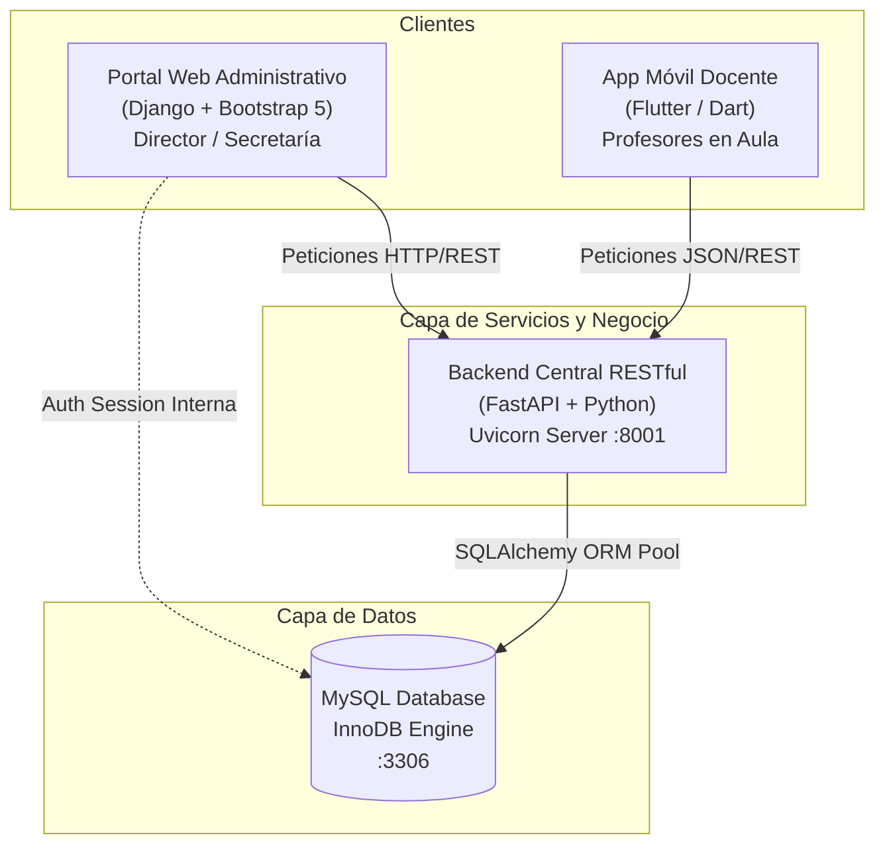
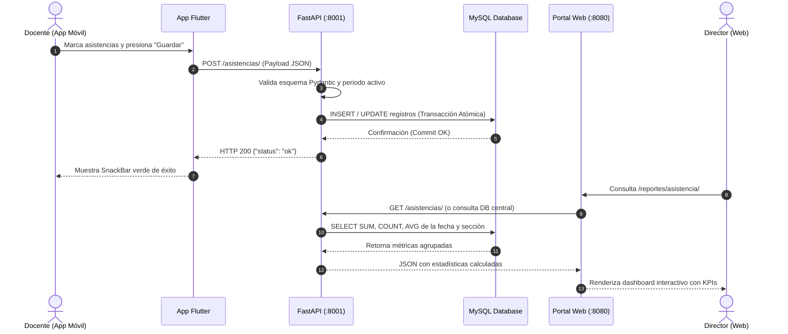

# DEFENSA TÉCNICA DEL SISTEMA INTEGRAL DE GESTIÓN Y CONTROL ESCOLAR (SIGE)
## Guía Estructurada para Presentación en Diapositivas (PPT)

---

### PRESENTACIÓN GENERAL Y FICHA TÉCNICA
* **Institución:** Complejo Educativo San Bartolomé
* **Proyecto:** Ecosistema Digital de Control Escolar (Web Administrativa + Móvil Docente + API Centralizada)
* **Stack Tecnológico:**
  - **Backend API:** FastAPI (Python 3.10+), SQLAlchemy ORM, Pydantic, Uvicorn
  - **Frontend Web (Administrativo):** Django Framework, Bootstrap 5, Jinja/Django Templates, Responsive Design
  - **Frontend Móvil (Operativo Docente):** Flutter (Dart), Material 3, SharedPreferences, REST Client
  - **Base de Datos:** MySQL Server (Motor InnoDB, Integridad Referencial Estricta)
* **Público Objetivo de la Defensa:** Jurado Calificador, Comité Técnico, Directivos Académicos

---

## DIAPOSITIVA 1: Portada Institucional
* **Título:** Sistema Integral de Gestión y Control Escolar (SIGE)
* **Subtítulo:** Ecosistema Tecnológico Desacoplado para la Administración Centralizada y Gestión Operativa de Aula
* **Elementos en Diapositiva:**
  - Logotipo Institucional del Complejo Educativo San Bartolomé
  - Autor(es) / Equipo de Desarrollo
  - Componentes: Portal Web Directivo | Aplicación Móvil Docente | API Restful Centralizada
  - Fecha de Defensa Técnica
* **Notas del Orador (Guion de Exposición):**
  > *"Estimados miembros del comité evaluador, hoy presentamos la defensa técnica del Sistema Integral de Gestión y Control Escolar (SIGE). Este proyecto responde a la necesidad de modernizar, agilizar y transparentar los procesos académicos y directivos de la institución, erradicando los libros de asistencia físicos y planillas manuales de notas mediante una solución tecnológica robusta, segura y escalable basada en estándares de la industria del software."*

---

## DIAPOSITIVA 2: Problemática y Justificación del Proyecto
* **Título:** Diagnóstico Institucional y Justificación Técnica
* **Puntos Clave (Bullets):**
  - **Desafío Operativo:** Toma de asistencias y notas en papel; retrasos de semanas en consolidación de datos directivos.
  - **Vulnerabilidad de Datos:** Riesgo de pérdida, alteración o extravío de registros físicos.
  - **Falta de Trazabilidad:** Imposibilidad de que el Director conozca en tiempo real la tasa de ausentismo o rendimiento escolar diario.
  - **Solución Propuesta:** Separación clara de dominios:
    - *Plataforma Móvil:* Enfocada 100% en la ergonomía y agilidad del docente dentro del salón de clases.
    - *Plataforma Web:* Enfocada en la gobernanza escolar, auditoría, reportería y toma de decisiones estratégicas.
* **Notas del Orador:**
  > *"El principal reto en los centros escolares radica en la desconexión entre el aula de clases y la dirección. Mientras que el docente requiere una herramienta ágil e inmediata para marcar presencia o calificar tareas sin depender de una computadora de escritorio, la dirección requiere consolidar métricas globales al instante. El SIGE resuelve este divorcio operativo a través de una arquitectura cliente-servidor completamente sincronizada."*

---

## DIAPOSITIVA 3: Arquitectura Global del Sistema (Arquitectura Desacoplada)
* **Título:** Arquitectura del Ecosistema de Software
* **Diagrama de Componentes (Mermaid):**

* **Puntos Clave:**
  - **Desacoplamiento Front/Back:** Los clientes (Web y Móvil) consumen contratos de datos estandarizados vía JSON.
  - **Escalabilidad Horizontal:** El motor de la API puede escalar independientemente de la interfaz web o de los dispositivos móviles.
  - **Única Fuente de Verdad:** Toda regla de negocio, cálculo de promedios y validaciones de ciclo lectivo residen centralizadas.
* **Notas del Orador:**
  > *"Técnicamente, no desarrollamos una aplicación monolítica tradicional. Diseñamos una arquitectura basada en servicios desacoplados. FastAPI opera como la columna vertebral del sistema, exponiendo servicios RESTful consumidos tanto por la aplicación móvil construida en Flutter como por el portal web administrativo en Django. Esto garantiza que cualquier regla aplicada sobre una nota o asistencia impacte de forma unificada e inmediata en todo el ecosistema."*

---

## DIAPOSITIVA 4: El Núcleo de Datos y Negocio: FastAPI Backend
* **Título:** Capa de Servicios: Backend con FastAPI & SQLAlchemy
* **Puntos Clave:**
  - **Alto Rendimiento Asíncrono:** Basado en ASGI (`uvicorn`), ideal para transacciones simultáneas de docentes marcando asistencia al mismo minuto.
  - **Validación Estricta de Esquemas (Pydantic):** Tipado estático en tiempo de ejecución; rechazo automático de datos corruptos o valores de notas fuera de rango (0.00 a 10.00).
  - **ORM SQLAlchemy:** Abstracción relacional segura, prevención nativa contra inyecciones SQL (`SQL Injection`) y manejo eficiente de sesiones/conexiones.
  - **Documentación Swagger / OpenAPI Integrada:** Contrato vivo de endpoints interactivos para auditoría y desarrollo continuo (`/docs`).
* **Endpoints Principales:**
  - `/auth/*`: Login, validación de perfil en vivo y verificación de tokens.
  - `/anios-lectivos/*`: Ciclos académicos y estados (Planificado, Activo, Cerrado).
  - `/asistencias/*`: Registro masivo de asistencia diaria por sección y fecha.
  - `/calificaciones/*`: Asentamiento de notas parciales y ponderadas por periodo.
* **Notas del Orador:**
  > *"Seleccionamos FastAPI por su velocidad y robustez técnica. Pydantic nos permite garantizar que una calificación jamás sea registrada si es negativa o superior a 10, o que un registro de asistencia contenga un estado no tipificado. Además, el pool de conexiones de SQLAlchemy nos asegura transacciones atómicas bajo el motor InnoDB de MySQL."*

---

## DIAPOSITIVA 5: Modelo de Datos Relacional (Integridad y Consistencia)
* **Título:** Arquitectura de Datos en MySQL (Motor InnoDB)
* **Entidades Principales y Relaciones:**
  - **Institución & Ciclo:** `anios_lectivos` -> `periodos_escolares` (Trimestres/Periodos).
  - **Usuarios & Roles:** `usuarios` (Director, Secretaría, Profesor) vinculados a `profesores`.
  - **Asignaciones Académicas:** `asignaturas` vinculadas a un Profesor, Grado/Sección y Año Lectivo.
  - **Estudiantes & Matrícula:** `estudiantes` vinculados a un Grado/Sección y Año Lectivo activo.
  - **Hechos Transaccionales:**
    - `asistencias`: Llave compuesta lógica `(estudiante_id, asignatura_id, fecha)`.
    - `calificaciones`: Llave compuesta `(estudiante_id, asignatura_id, periodo_id)`.
* **Mecanismos de Integridad:**
  - Restricciones `Foreign Key` con reglas de borrado controlado.
  - Campos de auditoría de estado (`estado: TINYINT(1)`) para bajas lógicas y bloqueo de ciclos finalizados.
* **Notas del Orador:**
  > *"La base de datos fue normalizada para evitar redundancias y preservar la integridad referencial. Una calificación o asistencia no puede existir en el vacío: depende estrictamente de un estudiante matriculado, una asignatura asignada y un periodo lectivo abierto. De este modo, protegemos la validez legal y académica de los expedientes estudiantiles."*

---

## DIAPOSITIVA 6: Seguridad, Autenticación y Matriz de Acceso (RBAC)
* **Título:** Seguridad de Acceso y Control de Roles (RBAC)
* **Matriz de Privilegios:**

| Módulo / Acción | Director | Secretaría | Docente (Móvil) |
| :--- | :---: | :---: | :---: |
| Apertura / Cierre de Ciclos Escolares | **Total** | Solo Lectura | Sin Acceso |
| Gestión de Usuarios (Crear/Suspender) | **Total** | Sin Acceso | Sin Acceso |
| Matrícula y Expediente de Alumnos | **Total** | **Total** | Solo Lectura |
| Toma de Asistencias Diarias en Aula | Solo Lectura | Solo Lectura | **Total (Sus materias)** |
| Registro de Calificaciones | Auditoría | Auditoría | **Total (Sus materias)** |
| Vista Consolidada de Asistencia y Notas | **Ejecutiva** | **Operativa** | Resumen propio |

* **Políticas de Sesión:**
  - Cifrado de contraseñas institucional.
  - Validación de estado activo en cada petición; si la Dirección desactiva a un usuario, su sesión queda invalidada en caliente.
* **Notas del Orador:**
  > *"El sistema implementa el principio de mínimo privilegio. La secretaria cuenta con acceso a la gestión de matrícula y secretaría académica, pero no puede crear nuevos usuarios directivos ni modificar el estado del año escolar. El docente en su teléfono únicamente puede registrar calificaciones y asistencias de las secciones y materias que tiene formalmente asignadas por la dirección."*

---

## DIAPOSITIVA 7: Plataforma Web - Módulo de Gobierno Escolar
* **Título:** Portal Web Administrativo: Control y Gobierno Institucional
* **Capacidades del Director y Secretaría:**
  - **Panel de Control (Dashboard):** Métricas instantáneas de estudiantes inscritos, personal docente activo y asignaturas impartidas.
  - **Gestión de Ciclos Lectivos (`Años Escolares`):**
    - Estados visuales normalizados: `Planificado` (Verde suave), `Activo / En Curso` (Azul primario), `Finalizado / Cerrado` (Gris oscuro).
    - Regla de cierre: Un ciclo finalizado bloquea el registro extemporáneo de notas o asistencias pasadas para preservar la validez del historial.
  - **Gestión Integral de Usuarios y Personal:**
    - Módulo centralizado para alta de Secretarias, Docentes y Directivos.
    - Activación, suspensión temporal o reseteo de contraseñas en tiempo real.
* **Notas del Orador:**
  > *"El portal web fue desarrollado pensando en la claridad administrativa. Eliminamos cualquier ambigüedad en los ciclos escolares mediante badges de estado explícitos. Además, el director cuenta con un control unificado del personal docente y administrativo, permitiendo dar de alta o suspender credenciales con efecto inmediato en todo el sistema."*

---

## DIAPOSITIVA 8: Plataforma Web - Consolidados Ejecutivos y Reportería
* **Título:** Portal Web: Consolidados de Asistencia y Calificaciones
* **1. Consolidado Ejecutivo de Asistencia (`/reportes/asistencia/`):**
  - Selector dinámico por Grado, Sección y Fecha.
  - **Indicadores Clave (KPIs):** Total Matriculados, Presentes, Ausentes, Justificados, y Porcentaje de Asistencia General de la jornada escolar.
  - Sábana detallada con estado individual por alumno para control de deserción escolar temprana.
* **2. Consolidado Académico de Notas (`/reportes/calificaciones/`):**
  - Matriz académica completa por Asignatura, Sección y Periodo.
  - Desglose por estudiante: Actividades (P1, P2), Examen Parcial y **Promedio Final**.
  - **Métricas de Calidad Educativa:** Promedio general de la sección, tasa de aprobados vs reprobados en tiempo real.
* **Notas del Orador:**
  > *"Aquí reside el mayor valor estratégico del sistema para el Director. En lugar de esperar a que termine el trimestre para recibir reportes en hojas de cálculo, el directivo ingresa a los consolidados en vivo. Puede detectar inmediatamente si en 7° Grado 'A' hay un 30% de inasistencia hoy, o si en Matemáticas el promedio del periodo está por debajo de la media institucional, permitiendo intervenciones pedagógicas oportunas."*

---

## DIAPOSITIVA 9: Plataforma Móvil (Flutter) - Herramienta de Aula
* **Título:** Aplicación Móvil Docente: Ergonomía y Eficiencia
* **Diseño Orientado al Docente de Aula:**
  - **Framework Flutter (Dart):** Renderizado de alto rendimiento a 60 fps, interfaz reactiva y código base limpio.
  - **Diseño Ergonómico (One-Hand Usage):** Botones de tamaño adecuado para evitar toques accidentales durante la clase.
  - **Filtro Estricto de Contenido:** El docente solo visualiza las materias y grados que le corresponden según su nombramiento institucional.
  - **Información Contextual:** Carga en cabecera el periodo lectivo vigente y el estado de la matrícula.
* **Notas del Orador:**
  > *"La aplicación móvil no es una simple adaptación del sitio web; fue concebida desde cero para el ritmo acelerado del docente en el aula. Utiliza la paleta corporativa institucional y una navegación intuitiva por pestañas que permite pasar de la lista de cursos al registro de asistencia o calificaciones en un solo toque."*

---

## DIAPOSITIVA 10: Móvil - Registro de Asistencia en Tiempo Real
* **Título:** Módulo Móvil de Asistencia: Agilidad Operativa
* **Flujo Operativo:**
```text
[Selección de Materia y Fecha] 
            │
            ▼
[Carga de Nómina Oficial de Alumnos]
            │
            ▼
[Marcación Rápida con 1 Toque: Presente | Ausente | Tardanza | Justificada]
            │
            ▼
[Contadores Dinámicos en Pantalla (P: 28 | A: 2 | T: 1)]
            │
            ▼
[Guardar Asistencia -> FastAPI -> Persistencia en MySQL]
```
* **Características Clave:**
  - Código de colores de alto contraste: Presente (Verde), Ausente (Rojo), Tardanza (Naranja), Permiso (Azul).
  - Estado inicial automático (optimización de clics): Los alumnos cargan por defecto en estado asistido.
  - Confirmación háptica y SnackBar institucional de confirmación.
* **Notas del Orador:**
  > *"El pase de lista tradicional consume entre 10 y 15 minutos de la clase. Con la app móvil del SIGE, el docente realiza el pase de lista de 35 estudiantes en menos de 60 segundos. Los contadores en la parte superior se actualizan en vivo conforme se toca a cada alumno y, al presionar 'Guardar', el dato ya está disponible en la pantalla del Director."*

---

## DIAPOSITIVA 11: Móvil - Registro de Evaluaciones y Calificaciones
* **Título:** Módulo Móvil de Calificaciones: Estándar Evaluativo
* **Características del Módulo:**
  - **Cumplimiento de Estructura de Evaluación:** Desglose de actividades continuas (Actividad 1, Actividad 2) y Evaluación de Periodo / Examen.
  - **Cálculo Automático de Ponderación:** La aplicación calcula el promedio ponderado del periodo inmediatamente según la fórmula institucional.
  - **Validación en Cliente y Servidor:** Imposibilidad de ingresar valores fuera de la escala oficial (0.00 a 10.00).
  - **Indicadores Visuales de Aprobación:** Resaltado de notas superiores a 6.00 (Aprobado) vs inferiores a 6.00 (Riesgo pedagógico).
* **Notas del Orador:**
  > *"El módulo de calificaciones elimina el error humano en los cálculos matemáticos de notas. El docente ingresa las evaluaciones individuales y el sistema calcula en tiempo real la nota final del trimestre. Al guardar, los datos quedan sincronizados y blindados, listos para emitir cuadros de honor o alertas de refuerzo escolar."*

---

## DIAPOSITIVA 12: Resiliencia y Ciclo de Vida de Sesión (Online vs Offline)
* **Título:** Arquitectura de Sesión y Blindaje de Credenciales
* **El Desafío Técnico Abordado:**
  - La persistencia local en dispositivos móviles mediante `SharedPreferences` agiliza el uso diario, pero puede causar que usuarios eliminados o suspendidos continúen viendo datos en caché.
* **La Solución de Doble Capa Implementada:**
  1. **Persistencia Rápida:** Inicio rápido con almacenamiento local de credenciales de sesión activa.
  2. **Validación en Vivo (`Online Re-validation`):**
     - En cada arranque y recarga de vista, la app consulta `GET /auth/me/{usuario_id}` al backend.
     - Si el servidor responde `HTTP 404` (usuario eliminado) o `HTTP 403` (usuario suspendido), la app **destruye automáticamente la memoria local** y redirige al usuario a la pantalla de login con aviso formal.
  3. **Cierre de Sesión Seguro:**
     - Diálogo de confirmación modal para prevenir salidas accidentales.
     - Limpieza profunda de tokens y variables en memoria.
* **Notas del Orador:**
  > *"En sistemas escolares la confidencialidad es crítica. Si un docente cesa funciones o es dado de baja en la base de datos, no podemos permitir que su teléfono mantenga el acceso abierto. Implementamos un mecanismo de revalidación en tiempo real: al momento en que la dirección elimina o suspende una cuenta, el próximo intento de la aplicación de sincronizar o abrir pantalla expulsa inmediatamente la sesión y purga los datos del teléfono."*

---

## DIAPOSITIVA 13: Flujo de Datos Extremo a Extremo (End-to-End)
* **Título:** Ciclo de Vida del Dato Escolar: De Aula a Dirección
* **Diagrama de Secuencia (Mermaid):**

* **Notas del Orador:**
  > *"Este diagrama sintetiza la coherencia de nuestro sistema. Cuando el docente hace clic en 'Guardar Asistencia' en su teléfono inteligente, el registro viaja validado por Pydantic hacia MySQL. Segundos después, cuando el Director en su oficina abre el portal web institucional, los gráficos y tablas ya reflejan la asistencia real de esa sección sin necesidad de llamadas telefónicas, papeles o intermediarios."*

---

## DIAPOSITIVA 14: Estándares de Ingeniería de Software y Calidad
* **Título:** Atributos de Calidad y Buenas Prácticas Aplicadas
* **Puntos Clave:**
  - **Separación de Responsabilidades (SoC):** Modelos, Vistas, Controladores y Capas de Servicio claramente aislados.
  - **Tolerancia a Fallos y Manejo de Red:** Timeouts controlados (5 segundos en llamadas móviles) para evitar bloqueos ante inestabilidad de red inalámbrica.
  - **Estandarización Terminológica:** Vocabulario académico profesional conforme a directrices educativas oficiales (Año Lectivo, Grado y Sección, Asignatura, Régimen Trimestral).
  - **Mantenibilidad y Código Limpio:** Estructuras modulares en Flutter (`screens`, `services`, `models`, `theme`) y Django (`apps`, `views`, `templates`).
* **Notas del Orador:**
  > *"Hemos seguido rigurosos principios de ingeniería de software. Cada capa tiene una responsabilidad única, lo que facilita el mantenimiento y futuras expansiones, como la incorporación de un portal para padres de familia o la generación de boletas de calificaciones en PDF mediante microservicios."*

---

## DIAPOSITIVA 15: Conclusiones y Demostración en Vivo
* **Título:** Conclusiones, Impacto y Demostración Práctica
* **Conclusiones Principales:**
  - **Eficiencia Operativa:** Reducción de más del 80% en tiempos de captura de asistencia y asentamiento de notas.
  - **Cero Redundancia:** Centralización de datos con respaldo relacional y sin duplicidad.
  - **Seguridad Garantizada:** Matriz de permisos RBAC con expulsión de sesiones no autorizadas.
  - **Escalabilidad Comprobada:** Capacidad de incorporar nuevos grados, docentes y periodos sin alterar el núcleo del sistema.
* **Puntos para la Demostración en Vivo:**
  1. *Paso 1:* Ingreso como Director al Portal Web (`director` / `director123`).
  2. *Paso 2:* Verificación del estado de los Años Escolares (2026 Activo, 2027 Planificado).
  3. *Paso 3:* Alta de un nuevo docente desde el módulo administrativo.
  4. *Paso 4:* Ingreso a la App Móvil con las nuevas credenciales y toma de asistencia en aula.
  5. *Paso 5:* Comprobación inmediata del reporte en el Consolidado Ejecutivo Web.
* **Notas del Orador:**
  > *"El Sistema Integral de Gestión y Control Escolar demuestra cómo la tecnología bien estructurada transforma la gestión de una institución educativa, devolviéndole a los docentes tiempo valioso de enseñanza y brindándole a los directores información certera para liderar con datos. A continuación, procederemos a la demostración práctica del ecosistema en vivo."*

---

### CONSEJOS CLAVE PARA LA DEFENSA ANTE EL JURADO
1. **Dominio del Stack:** Si preguntan por qué dos frameworks en Python (FastAPI y Django), enfatizar que **FastAPI** fue elegido por su velocidad y ligereza para servir la API REST pura para dispositivos móviles, mientras que **Django** aporta un ecosistema maduro y seguro con renderizado de servidor para paneles directivos.
2. **Defensa de la App Móvil:** Resaltar que Flutter compila a código nativo en ARM64, permitiendo transiciones fluidas y bajo consumo de batería en los teléfonos de los docentes.
3. **Seguridad y Auditoría:** Destacar que los ciclos escolares finalizados quedan bloqueados y que la revalidación de sesión en tiempo real previene brechas de seguridad ante suspensiones de personal.
