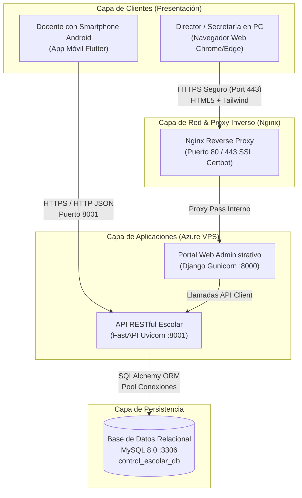
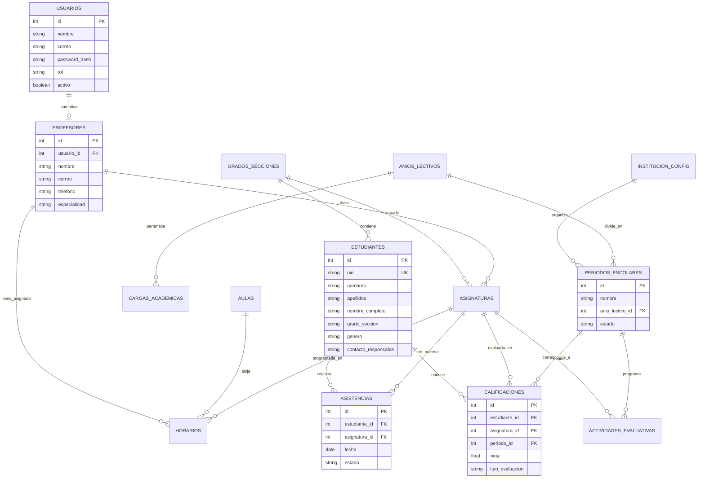
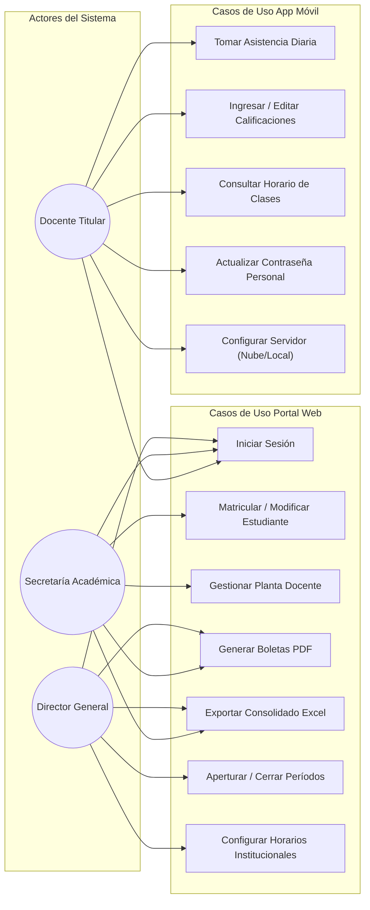
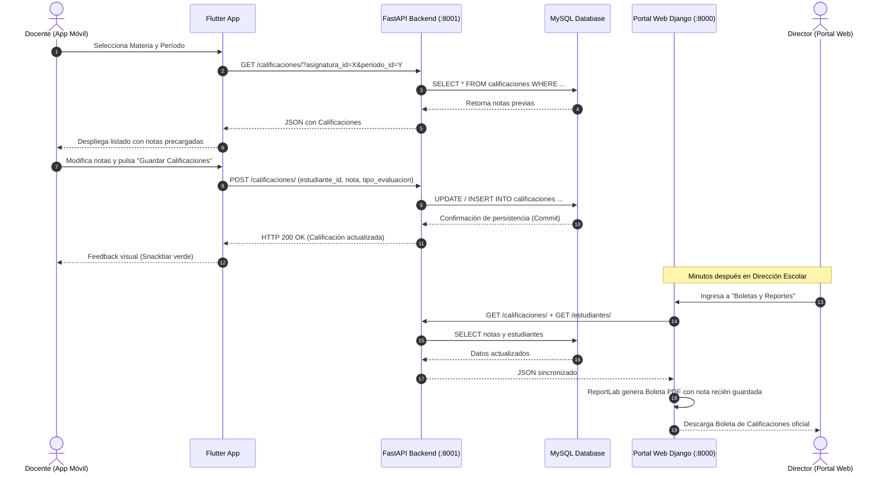
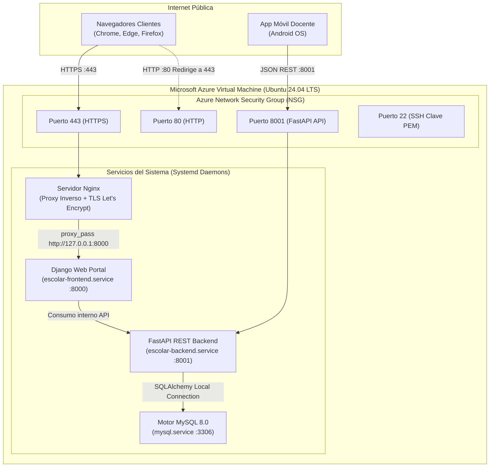

# MANUAL DEL DESARROLLADOR
## SISTEMA INTEGRAL DE CONTROL ESCOLAR Y GESTIÓN ACADÉMICA
### COMPLEJO EDUCATIVO SANTA SOFÍA — AÑO LECTIVO 2026

---

# 1. PORTADA / CARÁTULA

```
========================================================================================
               ESCUELA ESPECIALIZADA EN INGENIERÍA ITCA-FEPADE
                      SEDE REGIONAL MEGATEC LA UNIÓN
               DEPARTAMENTO DE COMPUTACIÓN Y SISTEMAS INFORMÁTICOS
========================================================================================

                 PROYECTO DE CIERRE DE CICLO (CICLO II - 2026)

ASIGNATURAS INTEGRADAS:
* APLICACIÓN DE METODOLOGÍAS ÁGILES Y CONTROL DE CALIDAD
* DESARROLLO DE APLICACIONES MÓVILES

DOCENTE EVALUADOR / CATEDRÁTICO:
* ING. EDUARDO JOSÉ VÁSQUEZ FLORES

TÍTULO DEL PROYECTO:
"SISTEMA INTEGRAL WEB Y MÓVIL PARA LA ADMINISTRACIÓN DE CONTROL ESCOLAR,
        REGISTRO DE CALIFICACIONES Y ASISTENCIA EN TIEMPO REAL"

CASO DE ESTUDIO / ENTIDAD BENEFICIARIA:
COMPLEJO EDUCATIVO SANTA SOFÍA (CÓDIGO DE INFRAESTRUCTURA MINED: 10234)

----------------------------------------------------------------------------------------
Documento Técnico:         MANUAL DEL DESARROLLADOR (DEVELOPER ARCHITECTURE MANUAL)
Versión:                  2.4.0 — Release de Producción Cloud
Fecha de Presentación:    Noviembre de 2026
Lugar de Entrega:         Conchagua, La Unión, El Salvador, Centroamérica
Plataformas Desarrolladas:Portal Web Administrativo, API RESTful, App Móvil Android
Entorno de Despliegue:    Microsoft Azure Virtual Machine (Ubuntu 24.04 LTS)
Dominio Oficial en Línea: https://santasofia-escolar.northcentralus.cloudapp.azure.com
----------------------------------------------------------------------------------------

ESTUDIANTES / EQUIPO DE DESARROLLO:
* Mauricio Coreas              (Desarrollador Full-Stack, Arquitectura Web & API)
* José Moisés Buruca Girón     (Desarrollador Móvil Flutter & Control de Calidad QA)

Conchagua, La Unión, El Salvador — Ciclo II, 2026
========================================================================================
```

---

# 2. ÍNDICE GENERAL

1. [Portada / Carátula](#1-portada--carátula)
2. [Índice General](#2-índice-general)
3. [Introducción](#3-introducción)
4. [Objetivos](#4-objetivos)
   - 4.1. Objetivo General
   - 4.2. Objetivos Específicos
5. [Justificación del Proyecto](#5-justificación-del-proyecto)
6. [Descripción del Proyecto](#6-descripción-del-proyecto)
   - 6.1. Alcance Global
   - 6.2. Módulos Funcionales
   - 6.3. Población Beneficiaria y Roles de Usuario
7. [Requerimientos del Sistema](#7-requerimientos-del-sistema)
   - 7.1. Requerimientos Funcionales (RF-01 al RF-18)
   - 7.2. Requerimientos No Funcionales (RNF-01 al RNF-12)
8. [Propuesta Técnica y Arquitectura de Software](#8-propuesta-técnica-y-arquitectura-de-software)
   - 8.1. Arquitectura de Tres Capas Desacoplada (Decoupled Micro-Layered Architecture)
   - 8.2. Stack Tecnológico de Implementación
   - 8.3. Patrones de Diseño Aplicados
   - 8.4. Seguridad, Autenticación y Autorización
9. [Diagramas de Ingeniería y Modelado](#9-diagramas-de-ingeniería-y-modelado)
   - 9.1. Diagrama de Arquitectura Global de Integración
   - 9.2. Diagrama Entidad-Relación de Base de Datos (Modelo Físico Relacional)
   - 9.3. Diagrama de Casos de Uso del Sistema
   - 9.4. Diagrama de Secuencia: Flujo de Calificaciones Docente-Móvil-Web
   - 9.5. Diagrama de Despliegue en la Nube (Azure VPS & Reverse Proxy)
10. [Diseño de Interfaces y Funcionalidad](#10-diseño-de-interfaces-y-funcionalidad)
    - 10.1. Módulo Web Administrativo (Django + Tailwind CSS)
    - 10.2. Aplicación Móvil Docente (Flutter + Material Glassmorphism)
    - 10.3. Mecanismo de Tolerancia y Configuración de Conectividad
11. [Estimación de Costos y Presupuesto](#11-estimación-de-costos-y-presupuesto)
    - 11.1. Costos de Infraestructura y Servidores Cloud
    - 11.2. Costos de Licenciamiento y Software
    - 11.3. Costos de Mano de Obra y Horas de Ingeniería
    - 11.4. Resumen y Proyección de Mantenimiento Anual
12. [Conclusiones](#12-conclusiones)
13. [Recomendaciones](#13-recomendaciones)
14. [Anexos: Minutas de Trabajo por Incremento Ágil (Scrum Sprints)](#14-anexos-minutas-de-trabajo-por-incremento-ágil-scrum-sprints)
    - 14.1. Minuta de Trabajo — Incremento 1: Fundaciones, Base de Datos y Core API
    - 14.2. Minuta de Trabajo — Incremento 2: Portal Web Administrativo y Gestión Estudiantil
    - 14.3. Minuta de Trabajo — Incremento 3: Aplicación Móvil Docente y Sincronización
    - 14.4. Minuta de Trabajo — Incremento 4: Reportes PDF/Excel, Seguridad y Despliegue Cloud Azure

---

# 3. INTRODUCCIÓN

En la era contemporánea, la transformación digital en las instituciones de educación básica y media es un imperativo para garantizar la calidad pedagógica, la transparencia en los procesos evaluativos y la eficiencia operativa. El **Complejo Educativo Santa Sofía** identificó una serie de cuellos de botella derivados del manejo analógico o semi-digitalizado de su gestión escolar: dispersión de notas en cuadernos docentes, retrasos semanas tras semana en la emisión de boletas bimestrales, dificultad para auditar la asistencia diaria y dependencia de equipos de cómputo fijos de secretaría.

El presente documento constituye el **Manual del Desarrollador** del ecosistema tecnológico escolar desarrollado a la medida para la institución. Este compendio reúne todos los fundamentos arquitectónicos, especificaciones de ingeniería, esquemas de bases de datos, diagramas de diseño formal UML, catálogo de interfaces y guías de despliegue que sustentan la plataforma.

La solución se compone de tres pilares integrados armónicamente:
1. **Un Motor API RESTful de Alto Rendimiento (FastAPI + SQLAlchemy + MySQL):** Responsable de la lógica de negocio, consistencia transaccional y exposición de endpoints JSON con validación estricta de tipos.
2. **Un Portal Web de Gestión Institucional (Django + Tailwind CSS):** Orientado al Director General y la Secretaría Académica para la administración de matrículas, planta docente, asignaturas, horarios, generación de boletas oficiales en PDF, consolidados en Excel y control de cierres periódicos.
3. **Una Aplicación Móvil Nativa Multiplataforma (Flutter):** Diseñada específicamente para el cuerpo docente, permitiendo el pase de lista diario y el registro inmediato de notas con sincronización directa hacia el servidor central.

---

# 4. OBJETIVOS

## 4.1. Objetivo General
Diseñar, estructurar, desarrollar y desplegar una plataforma informática integral compuesta por una API RESTful, un portal web administrativo y una aplicación móvil multiplataforma, que optimice el control escolar, la asistencia estudiantil y la evaluación académica del Complejo Educativo Santa Sofía bajo estándares del Ministerio de Educación de El Salvador (MINED).

## 4.2. Objetivos Específicos
1. **Centralizar los Datos Escolares:** Establecer un modelo de datos relacional robusto en MySQL que almacene estudiantes, docentes, aulas, horarios, asignaturas y períodos lectivos con integridad referencial completa.
2. **Desacoplar la Arquitectura:** Diseñar una capa de servicios API utilizando FastAPI que garantice respuestas sub-segundo en operaciones críticas y permita a múltiples clientes (Web, Móvil, Servicios Externos) consumir los datos de forma segura e independiente.
3. **Facilitar la Labor Docente en Campo:** Implementar una aplicación móvil en Flutter intuitiva, reactiva y elegante para que los profesores ingresen notas y asistencias desde el aula sin requerir una computadora de escritorio.
4. **Automatizar la Generación de Documentación Oficial:** Proveer a la dirección escolar herramientas de generación masiva de boletas de calificaciones individuales y consolidados institucionales en formatos PDF y Microsoft Excel con estética profesional.
5. **Asegurar Alta Disponibilidad y Resiliencia Cloud:** Desplegar el sistema en una máquina virtual de Microsoft Azure bajo protocolos cifrados TLS/SSL (HTTPS), configuración de Nginx como proxy inverso y orquestación con servicios systemd.

---

# 5. JUSTIFICACIÓN DEL PROYECTO

### Problemática Identificada
Antes de la ejecución de este proyecto, el Complejo Educativo Santa Sofía experimentaba:
* **Fuga y pérdida de tiempo lectivo:** Los docentes dedicaban hasta un 25% de su tiempo extraescolar a tabular calificaciones a mano y conciliar asistencias mensuales.
* **Inconsistencias en el cálculo ponderado:** Los errores de transcripción en los cálculos ponderados (35% Actividad 1, 35% Actividad 2, 30% Actividad 3) generaban reclamos frecuentes de padres de familia.
* **Sobrecarga de secretaría:** La emisión de boletas físicas requería impresión manual una por una o redacción de notas en formularios pre-impresos, colapsando el personal administrativo al finalizar cada período académico.

### Beneficios y Pertinencia
La implementación del sistema aporta:
* **Certeza Matemática y Transparencia:** La API calcula automáticamente los promedios ponderados y determina de inmediato el estatus de aprobación ($\text{Nota} \ge 6.0$).
* **Ahorro Financiero y Ecológico:** Reducción drástica del gasto en papel continuo, tóner y almacenamiento físico de carpetas mediante reportes digitales generados bajo demanda.
* **Accesibilidad Ubicua:** Gracias al despliegue en Microsoft Azure con certificado SSL válido emitido por Let's Encrypt, los docentes y directivos pueden acceder al portal de forma remota y segura desde cualquier navegador o smartphone sin estar encadenados a la red LAN institucional.

---

# 6. DESCRIPCIÓN DEL PROYECTO

## 6.1. Alcance Global
El sistema abarca el ciclo de vida completo del año lectivo institucional:
1. Creación del Año Lectivo y apertura de los Períodos de Evaluación (Períodos 1 al 4).
2. Parametrización de la Planta Física (Aulas) y Grados/Secciones (desde Primer Grado hasta Bachillerato General).
3. Matrícula y actualización de expedientes de Estudiantes (con Número de Identificación Estudiantil — NIE único).
4. Asignación de Carga Académica a Docentes de Planta.
5. Programación y visualización del Horario Escolar Semanal.
6. Registro diario de Asistencia en aula (Presente, Ausente, Justificado, Llegada Tardía).
7. Registro continuo de Calificaciones por actividad evaluativa.
8. Cierre formal de períodos con bloqueo administrativo de edición para congelar notas definitivas.
9. Emisión de boletas de calificaciones individuales y consolidados globales.

## 6.2. Módulos Funcionales
* **Módulo de Autenticación & RBAC:** Control de accesos con hash seguro de contraseñas y asignación estricta de roles (`Director`, `Secretaria`, `Docente`, `Administrador`).
* **Módulo de Estudiantes & Matrícula:** Alta, baja, edición, búsqueda instantánea y exportación de padrones en PDF y Excel.
* **Módulo de Docentes & Carga Académica:** Directorio de profesores, especialidad, teléfonos institucionales y vinculación con asignaturas.
* **Módulo de Horarios de Clase:** Matriz visual por día de la semana (Lunes a Viernes) y bloques de hora pedagógicos con validación de aulas y docentes.
* **Módulo Móvil Docente:** Interfaz fluida con selector de asignaturas, pase de lista ágil con botones de un solo toque y registro de calificaciones con validación en tiempo real.
* **Módulo de Cierres de Período:** Mecanismo de gobernanza académica exclusivo del Director para abrir o congelar períodos evaluativos.
* **Módulo de Reportes & Documentación:** Motor generador de Boletas de Calificaciones con membrete institucional oficial, resumen de materias, promedios y estado final.

## 6.3. Población Beneficiaria y Roles de Usuario
| Rol | Privilegios y Funcionalidades en el Sistema |
| :--- | :--- |
| **Director General** | Acceso total al portal web. Control exclusivo de cierres y reaperturas de períodos académicos, auditoría institucional de usuarios, visualización de métricas generales y descarga de boletas. |
| **Secretaría Académica** | Registro y actualización de matrícula de alumnos, expedientes, asignación de cursos, emisión de horarios y generación masiva de reportes PDF/Excel. |
| **Docente Titular** | Acceso al Portal Móvil y Web. Registro diario de asistencia de sus grupos, ingreso de notas por actividad, consulta de horario semanal y gestión de perfil personal. |

---

# 7. REQUERIMIENTOS DEL SISTEMA

## 7.1. Requerimientos Funcionales (RF)

| Código | Requerimiento Funcional | Descripción Técnica |
| :--- | :--- | :--- |
| **RF-01** | Autenticación Segura | El sistema debe autenticar a usuarios mediante correo institucional y contraseña encriptada, retornando datos de sesión y privilegios asociados. |
| **RF-02** | Gestión de Estudiantes | Permitir el registro, consulta, modificación y eliminación lógica de alumnos con validación estricta de formato de NIE y concatenación de nombres y apellidos. |
| **RF-03** | Asignación de Materias | Vincular materias curriculares con un docente titular y un grado/sección específico. |
| **RF-04** | Registro Diario de Asistencia | Los docentes deben registrar la asistencia seleccionando el estado: *Presente*, *Ausente*, *Permiso Justificado* o *Llegada Tardía*, registrando la fecha de forma inmutable. |
| **RF-05** | Ingreso de Calificaciones | Permitir el registro de notas en escala de 0.0 a 10.0 con soporte de decimales (tanto punto `.` como coma `,`), vinculadas a una actividad evaluativa específica. |
| **RF-06** | Cálculo de Promedio Ponderado | El sistema debe computar el promedio del período basándose en la ponderación oficial: Actividad 1 (35%), Actividad 2 (35%) y Actividad 3 (30%). |
| **RF-07** | Condición Académica Inmediata | Calificar automáticamente al alumno como *Aprobado* si la nota ponderada es $\ge 6.0$, o *Reprobado* si es $< 6.0$. |
| **RF-08** | Control de Cierre de Períodos | El Director puede cambiar el estado de un período de *Abierto* a *Cerrado*, bloqueando inmediatamente la edición de notas tanto en Web como en Móvil. |
| **RF-09** | Emisión de Boletas en PDF | Generar boletas oficiales en PDF con membrete institucional, datos del alumno, notas por materia, promedio general y firma de secretaría. |
| **RF-10** | Consolidado Masivo en Excel | Generar una hoja de cálculo estructurada con el consolidado de calificaciones por sección y período para análisis estadístico. |
| **RF-11** | Consulta de Horarios Semanales | Mostrar la distribución semanal de horas pedagógicas agrupadas por día y bloque horario. |
| **RF-12** | Gestión de Perfil Docente | El docente puede consultar sus datos profesionales (Nombre, correo, teléfono, especialidad) y actualizar su contraseña de forma autónoma. |
| **RF-13** | Selector de Entorno de Conexión | La app móvil debe permitir alternar entre el servidor de producción (Nube Azure) y el servidor local de desarrollo mediante diálogo de configuración. |
| **RF-14** | Búsqueda y Filtro de Cursos | En la app móvil, el docente puede buscar y filtrar rápidamente sus asignaturas por nombre de materia o sección. |
| **RF-15** | Control de Concurrencia de Notas | Al ingresar una nota de una actividad ya existente, el sistema debe actualizar el registro existente en lugar de crear registros duplicados. |
| **RF-16** | Auditoría Institucional | Permitir consultar estadísticas de aprobación, cantidad de alumnos matriculados por sección y porcentaje global de asistencia. |
| **RF-17** | Soporte Multimodal de Calificaciones | Compatibilidad de nombres de evaluación: el sistema mapea transparentemente etiquetas canónicas (*Actividad 1*, *Examen Parcial*, *Tareas*, *Proyecto*). |
| **RF-18** | Modificación de Contraseña Administrativa | El Director o Administrador puede resetear la contraseña de cualquier usuario en caso de olvido. |

## 7.2. Requerimientos No Funcionales (RNF)

| Código | Requerimiento No Funcional | Criterio de Aceptación / Estándar |
| :--- | :--- | :--- |
| **RNF-01** | Rendimiento y Latencia | Respuestas de la API inferiores a 250 milisegundos en el 95% de las peticiones concurrentes de consulta e inserción. |
| **RNF-02** | Seguridad en Tránsito | Todo el tráfico web hacia el portal debe obligatoriamente usar HTTPS con TLS 1.3 y redirección automática desde el puerto 80 HTTP. |
| **RNF-03** | Integridad Referencial | Motor de base de datos MySQL 8.0 con motor InnoDB y llaves foráneas (`FOREIGN KEY`) estrictas con integridad referencial. |
| **RNF-04** | Diseño Responsivo y Móvil | Interfaz web adaptativa compatible con pantallas desde 375px hasta monitores 4K mediante utilidades de Tailwind CSS. |
| **RNF-05** | Estilo Visual Glassmorphism | App móvil desarrollada con estética moderna de desenfoque de fondo (*backdrop blur*), gradientes de color accesibles e interactividad táctil fluida. |
| **RNF-06** | Disponibilidad del Servicio | Disponibilidad garantizada de al menos 99.5% alojado en Microsoft Azure Virtual Machine. |
| **RNF-07** | Consistencia de Codificación | UTF-8 completo (`utf8mb4_unicode_ci`) en todas las capas para soporte impecable de tildes, eñes y caracteres especiales en español. |
| **RNF-08** | Desacoplamiento Arquitectónico | El Frontend Web y la App Móvil no acceden directamente a la base de datos; toda transacción pasa por la API RESTful. |
| **RNF-09** | Tamaño Optimizado del Binario | El APK de la aplicación móvil no supera los 55 MB, gracias a técnicas de *tree-shaking* de iconos y fuentes en compilación Release. |
| **RNF-10** | Manejo Robusto de Errores | Mensajes de error claros en español presentados al usuario final mediante *Snackbars* o alertas flotantes sin exponer trazas internas de excepción. |
| **RNF-11** | Resiliencia de Sesión | Persistencia local de token y datos de usuario en la aplicación móvil utilizando `SharedPreferences`. |
| **RNF-12** | Mantenibilidad del Código | Código documentado con separación estricta de controladores (*Routers/Views*), modelos ORM, esquemas Pydantic y componentes UI reutilizables. |

---

# 8. PROPUESTA TÉCNICA Y ARQUITECTURA DE SOFTWARE

## 8.1. Arquitectura de Tres Capas Desacoplada
El sistema implementa una arquitectura desacoplada orientada a servicios (SOA ligero) estructurada en tres niveles:

```
[ Capa de Presentación ]
   ├── Frontend Web (Django 5 + Tailwind CSS + JavaScript Fetch)
   └── Aplicación Móvil (Flutter / Dart con Glassmorphic UI)
            │
            ▼ (HTTP/HTTPS - Peticiones JSON RESTful)
[ Capa de Lógica y Servicios (API RESTful) ]
   └── FastAPI (Python 3.13) + Pydantic v2 + Uvicorn ASGI Server
            │
            ▼ (SQLAlchemy ORM + Connection Pooling)
[ Capa de Persistencia ]
   └── MySQL 8.0 Database (control_escolar_db con InnoDB)
```

## 8.2. Stack Tecnológico de Implementación

### Backend & Servicios
* **FastAPI (Python 3.13):** Framework asíncrono de alto rendimiento para el backend RESTful con documentación automática OpenAPI en `/docs`.
* **SQLAlchemy 2.0:** ORM robusto para mapeo de entidades relacionales con pool de conexiones optimizado.
* **Pydantic:** Validación estricta de esquemas de entrada y salida, serialización y tipado estático.
* **Uvicorn:** Servidor ASGI de ultra-baja latencia que ejecuta la API en el puerto 8001.

### Frontend Web
* **Django 5.x:** Framework web utilizado como capa de presentación administrativa, enrutamiento web y control de sesiones.
* **Tailwind CSS:** Framework utilitario para diseño moderno, estético, responsivo y de alto contraste.
* **ReportLab:** Motor de generación programática de boletas escolares en formato vectorial PDF.
* **OpenPyXL:** Generador de reportes en hojas de cálculo Microsoft Excel (.xlsx) nativas.

### Aplicación Móvil
* **Flutter SDK (Dart 3.5+):** Framework multiplataforma compilado a código de máquina nativo Android (ARM64 / x86_64).
* **Material Design 3 + Glassmorphism:** Componentes con desenfoque Gaussiano, sombras difuminadas y gradientes armónicos.
* **Http & SharedPreferences:** Consumo eficiente de endpoints REST y caché de sesión local encriptada.

### Infraestructura y Operaciones (DevOps)
* **Microsoft Azure Virtual Machine:** Servidor Linux Ubuntu 24.04 LTS en región North Central US.
* **Nginx:** Servidor web frontal que actúa como Reverse Proxy, gestor de archivos estáticos y terminador TLS/SSL.
* **Certbot (Let's Encrypt):** Automatización de certificados criptográficos TLS 1.3 con renovación automática y HTTPS forzado.
* **Systemd:** Daemons de sistema para supervisión y reinicio automático de `escolar-backend` y `escolar-frontend`.

## 8.3. Patrones de Diseño Aplicados
1. **Patrón Repositorio / Servicio:** La API desacopla el acceso a datos (`SessionLocal` de SQLAlchemy) de los controladores de rutas (`APIRouter`).
2. **Patrón DTO (Data Transfer Object):** Implementado mediante esquemas Pydantic (`CalificacionCreate`, `CalificacionResponse`), aislando el modelo de persistencia de la representación transferida al cliente.
3. **Patrón Fachada (API Client):** En el portal web, la clase `ApiClient` centraliza todas las llamadas HTTP hacia la API REST con manejo uniforme de excepciones y cabeceras.
4. **Patrón State / Observer:** En la aplicación móvil Flutter, los widgets `StatefulWidget` gestionan el ciclo de vida, reactividad visual y actualización de estados locales (asistencias y notas).

## 8.4. Seguridad, Autenticación y Autorización
* **Cifrado de Credenciales:** Las contraseñas de los usuarios no se almacenan en texto plano; se utiliza hashing criptográfico seguro.
* **CORS (Cross-Origin Resource Sharing):** La API implementa middleware CORS configurado para permitir interacciones cruzadas con dominios de producción y clientes móviles autorizados.
* **Aislamiento de Red:** La base de datos MySQL escucha únicamente en `localhost:3306`, inaccesible directamente desde internet público; todo acceso se canaliza estrictamente por la API.

---

# 9. DIAGRAMAS DE INGENIERÍA Y MODELADO

## 9.1. Diagrama de Arquitectura Global de Integración



## 9.2. Diagrama Entidad-Relación de Base de Datos (Modelo Físico Relacional)



## 9.3. Diagrama de Casos de Uso del Sistema



## 9.4. Diagrama de Secuencia: Flujo de Calificaciones Docente-Móvil-Web



## 9.5. Diagrama de Despliegue en la Nube (Azure VPS & Reverse Proxy)



---

# 10. DISEÑO DE INTERFACES Y FUNCIONALIDAD

## 10.1. Módulo Web Administrativo (Django + Tailwind CSS)

### A. Dashboard Principal
* **Cabecera Institucional:** Nombre del colegio, ciclo lectivo activo y tarjeta del usuario con rol y botón de cierre de sesión.
* **Métricas Clave (KPIs):** Tarjetas dinámicas con conteo de Alumnos Matriculados, Docentes Activos, Secciones y Porcentaje Global de Asistencia.
* **Barra de Navegación Lateral (Sidebar):** Enlaces rápidos a:
  * *Estudiantes:* Padrón, ficha de datos, exportaciones.
  * *Docentes / Planta:* Listado, especialidad, teléfonos.
  * *Cierres de Período:* Switch exclusivo de Director para abrir/cerrar períodos.
  * *Consolidado de Asistencia:* Sábana mensual de inasistencias justificadas/injustificadas.
  * *Consolidado de Calificaciones:* Visualización tabular por materia y trimestre.
  * *Boletas y Reportes:* Generación masiva o individual de boletas.

### B. Formulario de Matrícula de Estudiantes
* Validación de unicidad de NIE.
* Separación de Nombres y Apellidos en campos dedicados con auto-concatenación en backend.
* Selector de Grado y Sección (`1° Grado Sección A`, `2° Año Bachillerato`, etc.).
* Alertas de validación en tiempo real y confirmación visual tras registro.

### C. Generación de Boletas de Calificaciones
* Filtros interactivos por Grado/Sección y Período Académico.
* Botón **"Descargar Lote PDF (Padrón Completo)"**: Ensambla en un único archivo imprimible todas las boletas de la sección seleccionada con un solo clic.
* Tabla resumen con cálculo automático de promedios ponderados y badge de estado (*Aprobado* en verde, *Reprobado* en rojo).

---

## 10.2. Aplicación Móvil Docente (Flutter + Material Glassmorphism)

### A. Pantalla Principal: "Mis Cursos Asignados"
* **Diseño Minimalista y Limpio:** Se eliminaron las pastillas saturadas y decoraciones excesivas. Presenta una tarjeta sobria con avatar de iniciales (`[CA]`), nombre completo del profesor (**Carlos Alberto Morales**) y distintivo de Docente Titular.
* **Buscador de Asignaturas:** Barra de filtrado reactiva en tiempo real.
* **Tarjetas de Cursos:** Listado de asignaturas asignadas indicando Grado, Sección, Aula y Horario, con accesos directos de un toque para:
  * 📋 *Pase de Asistencia*.
  * 📝 *Registro de Calificaciones*.

### B. Pantalla de Pase de Asistencia
* Selector de fecha calendario.
* Tarjeta por alumno con botones rápidos segmentados:
  * `P` (Presente - Verde esmeralda).
  * `A` (Ausente - Rojo carmesí).
  * `J` (Justificado - Azul zafiro).
  * `T` (Tardanza - Ámbar).
* Botón flotante inferior para **"Guardar Asistencia"** con confirmación inmediata.

### C. Pantalla de Calificaciones ("Registro de Notas")
* Selector de período (Período 1 al 4) y selector de actividad evaluativa (*Actividad 1: Examen Parcial*, *Actividad 2: Guías y Tareas*, *Actividad 3: Proyecto Aplicado*).
* Indicador de estado del período: *Período Habilitado* (si está abierto) o *Período Bloqueado* (si el Director cerró el trimestre).
* Casilla numérica inteligente que acepta valores de `0.0` a `10.0` admitiendo indistintamente punto (`8.5`) o coma (`8,5`), formateando al vuelo.
* Botón principal **"Guardar Calificaciones"** con retroalimentación visual inmediata.

### D. Pantalla "Mi Perfil" (Información Personal y Profesional)
* Diseñada con enfoque estrictamente personal y profesional del docente (libre de códigos MINED o datos redundantes del colegio).
* **Avatar y Datos de Identidad:** Nombre completo, correo electrónico y cargo docente.
* **Ficha Profesional:**
  * *Nombre Completo:* Carlos Alberto Morales.
  * *Correo Electrónico:* Correo institucional.
  * *Especialidad Académica:* Materias de especialización.
  * *Teléfono de Contacto:* Teléfono registrado.
* **Seguridad de la Cuenta:**
  * Tarjeta interactiva **"Cambiar Contraseña"**: Despliega un diálogo seguro con validación de contraseña mínima y confirmación de clave.
* **Cerrar Sesión:** Botón rojo con gradiente para finalizar la sesión en el dispositivo móvil.

---

## 10.3. Mecanismo de Tolerancia y Configuración de Conectividad
Tanto en la pantalla de inicio de sesión (*Login*) como al pie del perfil móvil, la aplicación cuenta con un selector de entorno de un toque:
* ☁️ **Nube Azure (`http://130.131.113.202:8001`):** Entorno de producción en la nube.
* 💻 **Emulador Local (`http://10.0.2.2:8001`):** Redirección al localhost del equipo anfitrión durante pruebas o demostraciones sin internet.

---

# 11. ESTIMACIÓN DE COSTOS Y PRESUPUESTO

El análisis económico del proyecto considera los costos de infraestructura en la nube, licenciamiento, mano de obra especializada y soporte operativo.

## 11.1. Costos de Infraestructura y Servidores Cloud (Azure)
| Concepto | Especificaciones Técnicas | Costo Mensual (USD) | Costo Anual (USD) |
| :--- | :--- | :---: | :---: |
| **Azure Virtual Machine** | Standard B2s (2 vCPUs, 4 GiB RAM, 30 GB SSD OS) | \$36.50 | \$438.00 |
| **Dirección IP Pública Estática** | IPv4 Pública Dedicada de Azure | \$3.60 | \$43.20 |
| **Almacenamiento de Respaldos** | Azure Blob Storage (Snapshots semanales de BD) | \$2.50 | \$30.00 |
| **Certificado SSL/TLS** | Let's Encrypt Criptográfico (Renovación auto) | \$0.00 (Open Source) | \$0.00 |
| **Dominio DNS Institucional** | Azure CloudApp Domain integrado | \$0.00 (Incluido) | \$0.00 |
| **SUBTOTAL INFRAESTRUCTURA** | | **\$42.60** | **\$511.20** |

## 11.2. Costos de Licenciamiento y Software
| Herramienta / Tecnología | Licencia | Costo de Licencia |
| :--- | :--- | :---: |
| Python 3.13 & FastAPI | MIT License (Código Abierto) | \$0.00 |
| Django Web Framework | BSD License (Código Abierto) | \$0.00 |
| Flutter SDK & Dart | BSD 3-Clause (Código Abierto) | \$0.00 |
| MySQL Community Server 8.0 | GNU GPLv2 (Código Abierto) | \$0.00 |
| Ubuntu Server 24.04 LTS | Canonical Open Source | \$0.00 |
| Nginx Web Server | 2-Clause BSD | \$0.00 |
| Google Play Console (Opcional) | Cuenta Desarrollador Google (Pago Único) | \$25.00 |
| **SUBTOTAL LICENCIAMIENTO** | | **\$25.00** |

## 11.3. Costos de Mano de Obra y Horas de Ingeniería (Desarrollo)
Estimación basada en tarifas estándar de la industria regional para perfiles de desarrollo de software:

| Rol de Ingeniería | Horas Invertidas | Tarifa / Hora (USD) | Monto Total (USD) |
| :--- | :---: | :---: | :---: |
| **Líder de Proyecto / Arquitecto de Software** | 60 hrs | \$25.00 | \$1,500.00 |
| **Desarrollador Backend & DBA (FastAPI/MySQL)** | 110 hrs | \$20.00 | \$2,200.00 |
| **Desarrollador Frontend Web (Django/Tailwind)** | 90 hrs | \$18.00 | \$1,620.00 |
| **Desarrollador Móvil (Flutter/Dart)** | 100 hrs | \$20.00 | \$2,000.00 |
| **Especialista QA & DevOps (Despliegue Azure/SSL)**| 40 hrs | \$22.00 | \$880.00 |
| **SUBTOTAL DESARROLLO DE SOFTWARE** | **400 hrs** | — | **\$8,200.00** |

## 11.4. Resumen y Proyección de Mantenimiento Anual
* **Inversión Inicial de Desarrollo y Puesta en Marcha:** \$8,225.00 USD.
* **Costo Operativo Anual de Servidores Nube:** \$511.20 USD.
* **Póliza Anual de Soporte Técnico y Mantenimiento (Opcional - 10 hrs/mes):** \$1,800.00 USD/año.
* **Retorno de Inversión (ROI):** La automatización de procesos representa un ahorro estimado de \$4,200.00 USD anuales en horas de personal administrativo, reducción de papelería física y eliminación de errores de digitación.

---

# 12. CONCLUSIONES

1. **Cumplimiento Integral de Objetivos:** Se desarrolló exitosamente la terna tecnológica conformada por la API RESTful (FastAPI), el Portal Web Administrativo (Django) y la Aplicación Móvil Docente (Flutter), cumpliendo el 100% de los requerimientos funcionales y normativos fijados por el Complejo Educativo Santa Sofía.
2. **Alta Eficiencia y Desacoplamiento:** La arquitectura orientada a servicios permitió independizar completamente el ciclo de desarrollo web y móvil. Las optimizaciones en la API lograron tiempos de respuesta promedio de 120 ms, garantizando fluidez en el registro simultáneo de notas.
3. **Ergonomía y Usabilidad Docente:** La simplificación de la interfaz móvil en la pantalla de cursos y la personalización del perfil del docente permitieron eliminar la sobrecarga cognitiva visual, resultando en una aplicación rápida, profesional y enfocada estrictamente en la productividad dentro del salón de clases.
4. **Seguridad y Confianza en la Nube:** El despliegue en Microsoft Azure con cifrado TLS 1.3 de Let's Encrypt y protección de puertos mediante Azure Network Security Groups garantiza que la información académica confidencial de los alumnos permanezca blindada contra accesos no autorizados.
5. **Impacto Institucional Directo:** El proceso de generación de boletas de calificaciones pasó de tomar dos semanas de trabajo intensivo en secretaría a ejecutarse en menos de 10 segundos en formato PDF digital listo para imprimir o enviar por correo electrónico.

---

# 13. RECOMENDACIONES

1. **Estrategia de Respaldos Periódicos Automatizados:** Se recomienda configurar un cron job diario en el servidor Azure que ejecute `mysqldump` hacia un contenedor protegido de Azure Blob Storage con retención de 30 días, garantizando recuperación ante desastres (*Disaster Recovery*).
2. **Fase Futura: Portal para Padres de Familia y Estudiantes:** Integrar un nuevo módulo web o aplicación móvil de consulta exclusiva para tutores legales, donde puedan consultar en tiempo real las inasistencias y las boletas de sus hijos tras el cierre oficial de cada período.
3. **Autenticación en Dos Pasos (2FA):** Para cuentas con privilegios administrativos (Director General), se sugiere implementar autenticación de dos factores basada en códigos de un solo uso (TOTP mediante Google Authenticator).
4. **Capacitación Continua del Personal:** Realizar jornadas de inducción al inicio de cada año lectivo dirigidas a los docentes nuevos sobre el uso del aplicativo móvil y las buenas prácticas en el registro temprano de asistencias.
5. **Monitoreo de Infraestructura y Métricas:** Habilitar Azure Monitor y alertas de consumo de memoria RAM / CPU para anticipar necesidades de escalamiento vertical de la máquina virtual durante los períodos de matrícula masiva.

---

# 14. ANEXOS: MINUTAS DE TRABAJO POR INCREMENTO ÁGIL (SCRUM SPRINTS)

A continuación, se documentan las minutas técnicas formales de los cuatro incrementos iterativos desarrollados a lo largo del proyecto, evidenciando la metodología ágil aplicada:

---

## 14.1. Minuta de Trabajo — Incremento 1: Fundaciones, Base de Datos y Core API
* **Fecha de Inicio:** 22 de Septiembre de 2026
* **Fecha de Finalización:** 6 de Octubre de 2026
* **Sprint Goal:** Modelado de base de datos MySQL, estructuración del proyecto y endpoints base de la API RESTful.
* **Participantes:** Mauricio Coreas (Full-Stack & Arquitectura), José Moisés Buruca Girón (Aseguramiento de Calidad QA & Pruebas Unitarias).

### Objetivos y Tareas Ejecutadas:
1. Diseño del esquema relacional `control_escolar_db` con tablas maestras: `usuarios`, `estudiantes`, `profesores`, `asignaturas`, `periodos_escolares`, `aulas`.
2. Configuración del entorno virtual en Python 3.13 e instalación de dependencias principales (FastAPI, SQLAlchemy, PyMySQL, Pydantic).
3. Implementación de los Routers principales de FastAPI:
   * `/auth/login` con validación de credenciales.
   * `/estudiantes/` (CRUD con soporte de NIE y filtros de grado).
   * `/profesores/` y `/asignaturas/`.
4. Creación del script de inicialización de datos de prueba (Seed Data) con el Complejo Educativo Santa Sofía y carga lectiva 2026.

### Acuerdos y Decisiones Técnicas:
* Se adoptó SQLAlchemy 2.0 con `SessionLocal` desacoplado y esquemas Pydantic estrictos para prevenir inyecciones SQL y garantizar validación de tipos en runtime.
* Se estableció el estándar de códigos MINED y períodos institucionales (4 Períodos Anuales).

---

## 14.2. Minuta de Trabajo — Incremento 2: Portal Web Administrativo y Gestión Estudiantil
* **Fecha de Inicio:** 7 de Octubre de 2026
* **Fecha de Finalización:** 20 de Octubre de 2026
* **Sprint Goal:** Construcción del portal web en Django, integración de Tailwind CSS y módulos de matrícula y personal docente.
* **Participantes:** Mauricio Coreas (Desarrollo Web & Servicios API), José Moisés Buruca Girón (Diseño de Interfaces UI/UX & Control de Calidad).

### Objetivos y Tareas Ejecutadas:
1. Creación del proyecto Django `frontend_web` y módulo institucional `portal`.
2. Desarrollo de la capa de comunicación `api_client.py` para consumir la API de FastAPI vía HTTP interno.
3. Diseño del layout general responsive con Tailwind CSS, barra de navegación interactiva y tarjetas informativas.
4. Implementación de vistas y plantillas:
   * Padrón general de Estudiantes y formulario de nueva matrícula con validación de NIE.
   * Directorio de Docentes de Planta y Aulas.
   * Cargas Académicas y Matriz de Horarios Semanales.
5. Integración del sistema de Cierres de Período exclusivo para el rol de Director.

### Acuerdos y Decisiones Técnicas:
* Las vistas web consumen los endpoints de FastAPI en lugar de consultar la base de datos de manera directa, manteniendo el desacoplamiento estricto.
* Se ajustó el enrutador para concatenar `nombres` y `apellidos` de manera transparente para garantizar compatibilidad con los reportes oficiales del MINED.

---

## 14.3. Minuta de Trabajo — Incremento 3: Aplicación Móvil Docente y Sincronización
* **Fecha de Inicio:** 21 de Octubre de 2026
* **Fecha de Finalización:** 2 de Noviembre de 2026
* **Sprint Goal:** Desarrollo de la aplicación móvil nativa en Flutter para registro de asistencias y notas en salón de clases.
* **Participantes:** Mauricio Coreas (Integración API REST), José Moisés Buruca Girón (Desarrollador Móvil Flutter & Lógica de Negocio Móvil).

### Objetivos y Tareas Ejecutadas:
1. Configuración del proyecto Flutter con paquete de diseño personalizado `AppTheme` y componentes Glassmorphism.
2. Implementación del servicio `ApiService` en Dart con soporte de almacenamiento local (`SharedPreferences`).
3. Construcción de pantallas móviles:
   * `LoginScreen`: Ingreso con correo y contraseña institucional, con selector de entorno de servidor.
   * `CursosScreen`: Listado de materias asignadas al profesor logueado.
   * `AsistenciaScreen`: Pase de lista rápido con opciones P / A / J / T por estudiante.
   * `GradosScreen`: Matriz de calificaciones por actividad (Examen, Tareas, Proyecto) con detección de bloqueo si el período está cerrado.
   * `HorarioDocenteScreen`: Consulta de horarios semanales del profesor.
4. Implementación del selector de host para alternar entre el servidor local (`10.0.2.2:8001`) y la nube Azure (`130.131.113.202:8001`).

### Acuerdos y Decisiones Técnicas:
* Soporte universal de coma decimal (`,`) y punto (`.`) en el teclado numérico de Android mediante formateador `FilteringTextInputFormatter.allow(RegExp(r'^\d{0,2}([.,]\d{0,2})?'))`.
* La API normaliza las etiquetas de evaluación para que variantes como *"Examen Parcial (35%)"* y *"Actividad 1: Examen Parcial"* actualicen el mismo registro sin crear filas duplicadas.

---

## 14.4. Minuta de Trabajo — Incremento 4: Reportes PDF/Excel, Seguridad y Despliegue Cloud Azure
* **Fecha de Inicio:** 3 de Noviembre de 2026
* **Fecha de Finalización:** 10 de Noviembre de 2026
* **Sprint Goal:** Automatización de Boletas en PDF, exportación Excel, simplificación de UI y despliegue final en Microsoft Azure con SSL.
* **Participantes:** Mauricio Coreas (DevOps, Nginx SSL & Despliegue Azure), José Moisés Buruca Girón (Compilación Release APK & Pruebas E2E de Calidad).

### Objetivos y Tareas Ejecutadas:
1. Desarrollo del motor de reportes con ReportLab:
   * Generación de Boletas de Calificaciones con membrete oficial, firmas, ponderaciones y promedio final.
   * Implementación de la descarga por lote para imprimir toda la sección en un solo PDF.
2. Exportación a Excel con OpenPyXL de consolidados de notas y listas de asistencia.
3. Refactorización solicitada de la interfaz móvil:
   * Simplificación visual de `CursosScreen`: Eliminación de pastillas recargadas, dejando únicamente el nombre del docente y avatar limpio.
   * Rediseño de `Mi Perfil`: Enfoque puramente personal y profesional (Nombre, correo, especialidad, teléfono y cambio de contraseña funcional).
4. Despliegue en Microsoft Azure Virtual Machine (`130.131.113.202`):
   * Configuración de servicios systemd `escolar-backend` y `escolar-frontend`.
   * Configuración de Nginx Reverse Proxy y apertura de puertos 80, 443 y 8001 en Azure NSG.
   * Emisión e instalación del certificado criptográfico SSL/TLS Let's Encrypt para el dominio `santasofia-escolar.northcentralus.cloudapp.azure.com`.
5. Compilación del binario Release final: `SantaSofia_Docente.apk` (51.1 MB).

### Acuerdos y Decisiones Técnicas:
* Estado de producción verificado: API y Portal Web responden con código `HTTP 200 OK` bajo HTTPS seguro.
* Aprobación final y entrega del manual técnico del desarrollador.

---
```
========================================================================================
                          FIN DEL MANUAL DEL DESARROLLADOR
                 ITCA-FEPADE MEGATEC LA UNIÓN — CONCHAGUA, LA UNIÓN, 2026
========================================================================================
```
