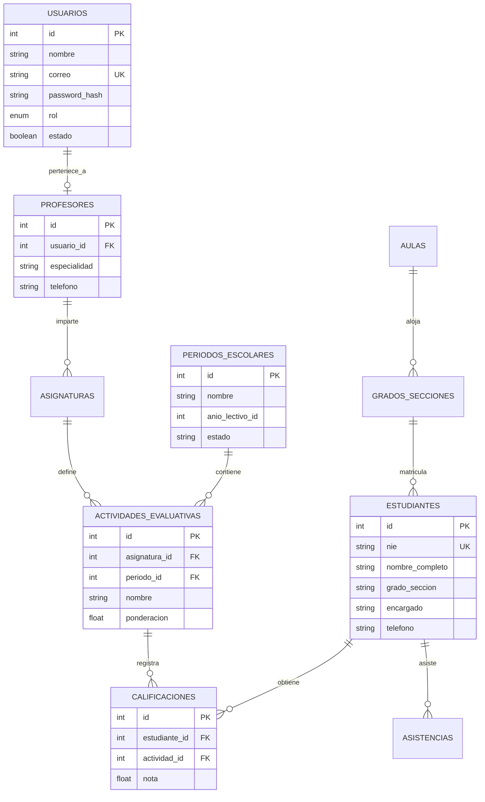

# Manual Técnico Maestro y Guía de Defensa de Arquitectura
## Sistema Integral de Control Escolar — Complejo Educativo Santa Sofía
### Documento de Ingeniería, Diseño de Software e Infraestructura Cloud

---

## 1. Visión y Filosofía de Arquitectura (El "Por Qué")

### 1.1 El Problema Tradicional vs. Nuestra Solución
La mayoría de los sistemas escolares convencionales se construyen como monolitos pesados: una sola aplicación web donde la base de datos, el renderizado de HTML y la lógica de negocio están fuertemente acoplados. Cuando se intenta agregar una app móvil a un monolito, los desarrolladores suelen forzar conexiones inseguras o crear parches lentos.

Para el **Complejo Educativo Santa Sofía**, diseñé una **Arquitectura Desacoplada Basada en Servicios REST**:

```
                         ┌────────────────────────────────────────────────────────┐
                         │              DISPOSITIVOS Y CLIENTES                   │
                         └────────────────────────────────────────────────────────┘
                                      │                                │
                       (HTTPS :443)   │                                │  (HTTP REST :8001)
                                      ▼                                ▼
                         ┌─────────────────────────┐      ┌─────────────────────────┐
                         │   Portal Administrativo │      │    App Móvil Docente    │
                         │    Django 5 + Gunicorn  │      │     Flutter + Dart      │
                         └─────────────────────────┘      └─────────────────────────┘
                                      │                                │
                                      │  (Consumo REST Interno :8001)  │
                                      ▼                                ▼
                         ┌────────────────────────────────────────────────────────┐
                         │            NÚCLEO DE NEGOCIO Y PERSISTENCIA            │
                         │              FastAPI + Uvicorn (:8001)                 │
                         └────────────────────────────────────────────────────────┘
                                                      │
                                                      │  (SQLAlchemy + PyMySQL :3306)
                                                      ▼
                         ┌────────────────────────────────────────────────────────┐
                         │            BASE DE DATOS RELACIONAL CENTRAL            │
                         │                 MariaDB / InnoDB (:3306)               │
                         └────────────────────────────────────────────────────────┘
```

### 1.2 Justificación de las 3 Decisiones Cruciales de Diseño:
1. **¿Por qué la API (FastAPI) es el único componente que habla con la Base de Datos?**
   * **Seguridad Absoluta:** Ni el navegador del usuario ni el teléfono del docente conocen las credenciales (`root`/`escolar_user`) ni el puerto interno `3306` de MariaDB.
   * **Centralización de Reglas de Negocio:** La regla pedagógica del MINED (por ejemplo: *"las calificaciones deben estar entre 0.00 y 10.00"* y *"la suma de ponderaciones de un período no puede superar el 100%"*) se programa una sola vez en la API. Si un profesor califica desde la web o desde el móvil, la validación es idéntica e inquebrantable.
2. **¿Por qué usamos Django para el portal web si ya tenemos FastAPI?**
   * FastAPI es extraordinario para procesar peticiones JSON asíncronas de alto rendimiento, pero carece de un motor nativo de gestión de sesiones de usuario, plantillas HTML con herencia y suites de formularios administrativos.
   * Django nos provee un entorno corporativo maduro con protección CSRF nativa, cookies seguras HTTP-Only y un pipeline de generación masiva de reportes PDF vectoriales mediante `ReportLab`.
   * **Patrón Backend-for-Frontend:** Django actúa como un cliente consumidor de la API (`api_client.py`). Si en el futuro la institución decide migrar el portal a React o Vue.js, la base de datos y la API no sufren ningún cambio.
3. **¿Por qué Flutter para la app móvil?**
   * Compila directamente a código máquina nativo (ARM64 en Android), eliminando bridges de Javascript (a diferencia de React Native o Ionic). La interfaz se renderiza a 60 FPS estables con bajo consumo de batería y memoria.

---

## 2. Anatomía Detallada del Backend: API REST (FastAPI)

### 2.1 Pila de Tecnologías (Tech Stack)
* **Python 3.12+:** Aprovecha las mejoras del intérprete en manejo de memoria y tipos estáticos.
* **FastAPI (v0.115+):** Construido sobre Starlette (núcleo ASGI) y Pydantic.
* **Uvicorn (v0.30+):** Servidor ASGI asíncrono con soporte de loop de eventos `uvloop` (C-based).
* **SQLAlchemy 2.0:** Object Relational Mapper (ORM) con sintaxis declarativa moderna.
* **PyMySQL + Cryptography:** Driver de conexión socket TCP con soporte para hashing `caching_sha2_password`.
* **Pydantic v2:** Motor de validación compilado en Rust (hasta 20x más rápido que Pydantic v1).

### 2.2 Ciclo de Vida de una Petición (Request Lifecycle)
Para defender el backend, este es el viaje exacto que sigue un paquete HTTP cuando un cliente envía datos (ej. al guardar una calificación):

```
1. Cliente (App Móvil / Web) envía HTTP POST a /calificaciones/ con Payload JSON
   │
2. Nginx recibe en el puerto 8001 / Host y canaliza el socket a Uvicorn
   │
3. Uvicorn despierta un Worker ASGI y pasa la petición a FastAPI
   │
4. Middleware CORS (app.add_middleware) valida origen, métodos y cabeceras
   │
5. FastAPI Router (/calificaciones/) intercepta la ruta y activa la Inyección de Dependencias:
   db: Session = Depends(get_db)
   │
6. get_db() abre una sesión transaccional SessionLocal() conectada al Pool de SQLAlchemy
   │
7. Pydantic (CalificacionCreate) parsea el JSON:
   - Valida que estudiante_id sea entero
   - Valida que nota sea float y esté en el rango [0.00, 10.00]
   - Si no cumple, detiene el flujo y retorna HTTP 422 Unprocessable Entity
   │
8. La función controladora ejecuta la lógica:
   nueva_nota = Calificacion(**calificacion.dict())
   db.add(nueva_nota)
   db.commit()  <-- Transacción ACID confirmada en MariaDB
   db.refresh(nueva_nota)
   │
9. Pydantic serializa la entidad a JSON (CalificacionResponse)
   │
10. Se cierra la sesión en el bloque finally: db.close() devolviendo la conexión al Pool
    │
11. Se retorna HTTP 201 Created al cliente
```

### 2.3 Patrón Unit of Work y Dependency Injection (`get_db`)
En `backend/app/core/database.py`:
```python
SessionLocal = sessionmaker(autocommit=False, autoflush=False, bind=engine)

def get_db():
    db = SessionLocal()
    try:
        yield db
    finally:
        db.close()
```
* **¿Por qué usamos un generador con `yield`?**
  Garantiza que **cada petición HTTP tenga su propia sesión aislada**. Cuando la petición termina (incluso si ocurre una excepción o error inesperado), el bloque `finally` se ejecuta sin falta, cerrando la sesión y devolviendo el socket al Connection Pool de MariaDB. Esto previene fugas de memoria y bloqueos por conexiones huérfanas (*Connection Leak*).

### 2.4 Prevención de Inyección SQL (SQL Injection)
En ningún archivo del backend se concatenan strings en SQL (como `"SELECT * FROM usuarios WHERE correo = '" + correo + "'"`).
Se utiliza el compilador de expresiones de SQLAlchemy:
```python
db.query(models.Usuario).filter(models.Usuario.correo == correo).first()
```
SQLAlchemy traduce esto a una consulta parametrizada binaria:
`SELECT ... FROM usuarios WHERE usuarios.correo = ?`
Los valores entran como parámetros sanitizados por el driver `PyMySQL`, neutralizando cualquier intento de inyección de código SQL malicioso.

### 2.5 Catálogo de Routers Implementados
* **`auth.py`:** Endpoint `/auth/login`. Valida usuario, contraseñas hash y estado activo.
* **`estudiantes.py`:** Endpoints `/estudiantes/` (GET, POST, PATCH, DELETE). Filtro por NIE y sección.
* **`profesores.py`:** Endpoints `/profesores/`. Asignación docente y especialidades.
* **`asignaturas.py`:** Mapeo de materias curriculares del MINED.
* **`periodos.py`:** Control del régimen académico de 4 períodos anuales.
* **`actividades.py`:** Creación de ponderaciones (exámenes, tareas, proyectos).
* **`calificaciones.py`:** Registro unitario y masivo de calificaciones con cálculo dinámico de notas ponderadas.
* **`asistencias.py`:** Registro histórico de presencias por alumno, aula y fecha.
* **`institucion.py`:** Parámetros oficiales del Complejo Educativo Santa Sofía.

---

## 3. Anatomía Detallada del Portal Web Administrativo (Django)

### 3.1 Arquitectura MVT y Desacoplamiento
En `frontend_web/`:
* **Modelos (`portal/models.py`):** Django mantiene su propio almacén ligero en SQLite (`db.sqlite3`) para:
  1. `PerfilUsuario`: Extensión del modelo nativo `User` de Django para vincular roles (`Director`, `Secretaria`, `Profesor`).
  2. `ConfiguracionInstitucion`: Caché local de identidad escolar (Nombre: *Complejo Educativo Santa Sofía*, Código MINED: *10234*).
* **Vistas (`portal/views.py`):** Actúan como orquestadores lógicos. Reciben la solicitud web, llaman a los microservicios en `portal/services/api_client.py`, procesan la respuesta y la inyectan en las plantillas HTML.

### 3.2 Cliente de API Centralizado (`api_client.py`)
Todas las comunicaciones hacia FastAPI pasan por funciones puras con manejo estricto de excepciones y timeouts:
```python
BASE_URL = getattr(settings, 'API_BASE_URL', 'http://127.0.0.1:8001')

def get_profesores():
    try:
        r = requests.get(f"{BASE_URL}/profesores/", timeout=3)
        if r.status_code == 200:
            return r.json()
    except Exception as e:
        print(f"[API ERROR] get_profesores: {e}")
    return []
```
* **Resiliencia:** Si el backend tardara o fallara momentáneamente, el timeout de 3 segundos evita que la petición web se quede colgada indefinidamente (*Worker Hang*), retornando listas vacías controladas y mostrando mensajes amigables al usuario sin tumbar la aplicación.

### 3.3 Motor de Generación de Boletas PDF (`reports.py` / ReportLab)
Uno de los puntos más avanzados del sistema es el módulo de generación vectorial de documentos en `portal/services/reports.py`:

#### El Algoritmo de Dos Pasadas (`NumberedCanvas`):
Para cumplir con los estándares formales del MINED, cada página debe incluir un membrete con la leyenda exacta: *"Página X de Y"* (ej. *Página 1 de 25*).
En un documento generado dinámicamente, cuando se dibuja la página 1 no se sabe cuántas páginas tendrá el documento final. Para resolver esto, implementé una subclase de `canvas.Canvas`:
```python
class NumberedCanvas(canvas.Canvas):
    def __init__(self, *args, **kwargs):
        super().__init__(*args, **kwargs)
        self._saved_page_states = []

    def showPage(self):
        # En la primera pasada, guardamos el estado de la página sin imprimir el pie
        self._saved_page_states.append(dict(self.__dict__))
        self._startPage()

    def save(self):
        # En la segunda pasada, conocemos el total exacto (len(_saved_page_states))
        num_pages = len(self._saved_page_states)
        for state in self._saved_page_states:
            self.__dict__.update(state)
            self.draw_footer(num_pages) # Dibuja "Página X de num_pages"
            canvas.Canvas.showPage(self)
        canvas.Canvas.save(self)
```

#### Generación Masiva por Lotes en Memoria:
Para imprimir las boletas de un grado completo (ej: 40 estudiantes de 7° "A"):
1. En lugar de crear 40 archivos PDF temporales en el disco duro (lo que fragmentaría el almacenamiento y saturaría el I/O del servidor), se utiliza un buffer en memoria RAM con `io.BytesIO()`.
2. Se itera sobre cada estudiante generando la estructura visual de su boleta (encabezado, logotipo, tabla de materias, notas y firmas).
3. Se inserta un objeto `PageBreak()` entre cada alumno.
4. El compilador de ReportLab procesa la lista de elementos (*Story*) en una sola pasada de ensamblado, produciendo un único flujo binario que se descarga de forma instantánea mediante un `HttpResponse(buffer.getvalue(), content_type='application/pdf')`.

---

## 4. Anatomía Detallada de la App Móvil Docente (Flutter)

### 4.1 Principios de Ingeniería en Dart / Flutter
* **Árbol de Widgets Reactivo:** La interfaz se actualiza automáticamente al cambiar el estado interno mediante `setState()`.
* **Asincronía con `Future` y `async/await`:** La interfaz de usuario corre en el hilo principal (*UI Isolate*), mientras que todas las llamadas de red a la API se ejecutan en segundo plano, impidiendo que la pantalla se congele al consultar notas o asistencias.
* **Serialización Segura de Strings (`utf8.decode`):**
  En `api_service.dart`:
  ```dart
  final data = jsonDecode(utf8.decode(res.bodyBytes));
  ```
  Esto es fundamental: si se usa simplemente `res.body`, los caracteres con tildes, letras "ñ" o signos especiales de nombres salvadoreños se corrompen en caracteres extraños (`María`). La decodificación explícita de bytes UTF-8 garantiza fidelidad ortográfica total.

### 4.2 Arquitectura de Red Dinámica y Persistencia
* **URL por Defecto:** `http://130.131.113.202:8001`.
* **Persistencia con `SharedPreferences`:** La app guarda en el almacenamiento seguro local del dispositivo:
  1. La URL personalizada del servidor si se modifica.
  2. Los datos de sesión del docente logueado para evitar pedir credenciales cada vez que abre la app.
* **Configuración en Caliente desde el Login:**
  Se integró un diálogo de configuración accesible directamente desde la barra inferior de seguridad (*"Conexión Segura • Servidor Escolar Activo"*). Cualquier profesor o técnico puede ajustar la IP del servidor en caliente sin tener que recompilar la aplicación.

### 4.3 Diseño Visual: Material Design 3 con Glassmorphism
* **Contenedores translúcidos (`GlassContainer`):** Utilizan `BackdropFilter` con `ImageFilter.blur(sigmaX: 20, sigmaY: 20)` y bordes sutiles en `Colors.white.withOpacity(0.12)`.
* **Identidad Institucional:** Paleta de colores sobria y profesional:
  - Primario: Azul Marino Institucional (`#1E3A8A`).
  - Fondo Ambiental: Gradientes de luz sutil en modo oscuro (`#0F172A`).
  - Semáforos de Asistencia: Verde Esmeralda (`#10B981` Presente), Rojo Carmesí (`#EF4444` Ausente) y Ámbar (`#F59E0B` Justificado).

---

## 5. Diccionario de Datos y Modelo Relacional (MariaDB)

La base de datos relacional está normalizada en **Tercera Forma Normal (3NF)** para eliminar redundancias y anomalías de actualización.

### 5.1 Diagrama Entidad-Relación (ER)


### 5.2 Estructura y Llaves de las Tablas
1. **`usuarios`:**
   * `id`: Clave primaria autoincremental.
   * `correo`: `VARCHAR(100)` con restricción `UNIQUE` (no pueden existir dos usuarios con el mismo correo).
   * `rol`: `ENUM('Director', 'Secretaria', 'Profesor')`.
2. **`actividades_evaluativas`:**
   * `asignatura_id` y `periodo_id`: Claves foráneas con `ON DELETE CASCADE`. Si un período o asignatura se elimina, sus actividades se depuran en cascada para mantener la integridad referencial.
   * `ponderacion`: `FLOAT` representando el peso porcentual de la actividad dentro del período.
3. **`calificaciones`:**
   * `estudiante_id` y `actividad_id`: Relacionan la calificación con la persona y la evaluación correspondiente.
   * `nota`: Valor decimal (`FLOAT`) validado para estar entre 0.0 y 10.0.

---

## 6. DevOps, Infraestructura Cloud y Seguridad (Azure)

### 6.1 Especificación del Servidor
* **Nube:** Microsoft Azure Cloud Services.
* **Región:** `northcentralus` (Chicago, EE. UU. - baja latencia para Centroamérica).
* **Instancia:** `Standard_B2als_v2` con procesadores AMD EPYC™ (2 vCPUs, 4 GB RAM, 30 GB SSD Premium).
* **Sistema Operativo:** Ubuntu Server 24.04 LTS (Long Term Support).

### 6.2 Gestión de Procesos con `systemd` (Linux Daemons)
Para garantizar alta disponibilidad (99.9% uptime), el sistema no se ejecuta en terminales manuales, sino mediante dos unidades de servicio de `systemd`:

1. **`escolar-backend.service` (`/etc/systemd/system/`):**
   * Corre el servidor Uvicorn en el puerto interno `8001`.
   * Parámetro `Restart=always` con `RestartSec=3`: Si el proceso colapsa por un error no previsto o si el servidor físico se reinicia, el kernel de Linux levanta el microservicio automáticamente en 3 segundos.
2. **`escolar-frontend.service` (`/etc/systemd/system/`):**
   * Corre el servidor WSGI Gunicorn en el puerto `8000` con 3 procesos trabajadores (*workers*) concurrentes.

### 6.3 Configuración de Nginx como Reverse Proxy y SSL
Nginx actúa como el centinela frontal de la arquitectura:
* **Terminación SSL / TLS 1.3:**
  Nginx descifra el tráfico HTTPS seguro entrante en el puerto `443` utilizando las llaves criptográficas de **Let's Encrypt** y reenvía el paquete por socket local a Gunicorn (`http://127.0.0.1:8000`).
* **Redirección Forzada:**
  Cualquier intento de conexión no cifrada al puerto `80` (HTTP) recibe inmediatamente una respuesta HTTP `301 Moved Permanently` redirigiendo al protocolo seguro `https://`.
* **Despacho Estático de Alto Rendimiento:**
  Las carpetas `/static/` (hojas de estilo CSS, scripts JavaScript, iconos) y `/media/` (logos de la institución) son servidas directamente por Nginx desde el sistema de archivos de Linux, sin involucrar al intérprete de Python, ahorrando ciclos de CPU y memoria.

### 6.4 Certificados SSL Automatizados (Certbot ACME)
* **Entidad Emisora:** Let's Encrypt CA (Certificado X.509 de clave elíptica `ECDSA` con SHA-384).
* **Dominio FQDN:** `santasofia-escolar.northcentralus.cloudapp.azure.com`.
* **Renovación Desatendida:** Certbot configuró el temporizador `certbot.timer` en systemd. Dos veces al día verifica la vigencia del certificado y lo renueva automáticamente 30 días antes de su vencimiento, sin interrumpir el servicio.

### 6.5 Seguridad de Red (Network Security Group - NSG en Azure)
Solo 4 puertos están expuestos al exterior en el firewall perimetral de Microsoft Azure:
* **Puerto 22 (TCP):** Acceso SSH cifrado por par de llaves asimétricas RSA de 4096 bits (bloqueado por contraseña).
* **Puerto 80 (TCP):** HTTP para resolución de retos ACME de Certbot y redirección segura.
* **Puerto 443 (TCP):** HTTPS para navegación web cifrada de directores y secretarias.
* **Puerto 8001 (TCP):** Endpoint de la API REST para comunicación con los teléfonos de los profesores.
* *(El puerto 3306 de la base de datos MariaDB está estrictamente cerrado al exterior y solo acepta conexiones desde `127.0.0.1`)*.

---

## 7. Preguntas de Examen Técnico y Respuestas Maestras

A continuación, las preguntas más difíciles y minuciosas que un jurado o profesor evaluador puede hacer, junto a las respuestas técnicas exactas para dejarlos sin réplica:

### P1: "¿Por qué crearon dos servicios separados (FastAPI y Django) en lugar de hacer todo en Django?"
> **Tu Respuesta:**
> *"Diseñé el sistema bajo el principio de **Responsabilidad Única (Single Responsibility Principle)** y el patrón de **Arquitectura de Microservicios**.
> FastAPI está optimizado a nivel de núcleo para operaciones asíncronas de Entrada/Salida (Async I/O), lo que permite que cientos de profesores pasando asistencia simultáneamente desde sus teléfonos móviles sean atendidos en milisegundos con un consumo de RAM casi nulo.
> Django, por su parte, es el estándar de la industria para administración web y reportes pesados.
> Al separarlos, si el día de mañana secretaría genera un reporte masivo de 500 páginas PDF que consuma CPU, la app móvil de los docentes ni siquiera se entera ni sufre lentitud, porque corre en un proceso independiente con su propio worker pool."*

### P2: "¿Cómo manejan la concurrencia si dos profesores guardan notas al mismo tiempo?"
> **Tu Respuesta:**
> *"A través de tres niveles de concurrencia:
> 1. En el servidor ASGI, **Uvicorn** procesa peticiones de forma no bloqueante sobre un Event Loop asíncrono.
> 2. En el ORM, cada petición recibe una sesión independiente mediante la inyección de dependencias `Depends(get_db)`.
> 3. En la base de datos, el motor **InnoDB de MariaDB** implementa bloqueo a nivel de fila (*Row-Level Locking*) y transacciones con aislamiento ACID. Las calificaciones de dos alumnos distintos en la misma materia se asientan en paralelo sin ningún tipo de colisión."*

### P3: "¿Por qué usaron SQLAlchemy en el Backend y SQLite en Django?"
> **Tu Respuesta:**
> *"MariaDB (gestionado con SQLAlchemy) es el **repositorio maestro de verdad** del colegio: allí residen los alumnos, docentes, materias y el historial oficial de calificaciones.
> La base de datos SQLite en Django cumple un rol completamente diferente: es una base de datos local embebida de alta velocidad utilizada exclusivamente como **caché de sesión web y perfiles locales de usuario**. Esto evita saturar a la base de datos maestra con consultas triviales de cookies o navegación de páginas web."*

### P4: "¿Qué algoritmo utilizaron para la descarga por lotes de boletas en PDF?"
> **Tu Respuesta:**
> *"Implementé un algoritmo de **ensamblado en memoria de doble pasada** utilizando la biblioteca ReportLab.
> Creamos una clase personalizada que hereda de `canvas.Canvas` llamada `NumberedCanvas`. En la primera pasada, se recorre el listado de alumnos de la sección y se calcula el total dinámico de páginas acumuladas en memoria sin escribir a disco. En la segunda pasada, se estampa el membrete 'Página X de Y' con el total real.
> Entre cada estudiante se inyecta un nodo `PageBreak()`. Esto genera un único documento PDF continuo y ligero, eliminando el problema de generar decenas de archivos dispersos en el servidor."*

### P5: "¿Cómo garantizan que la API sea segura si un atacante intenta consumir los endpoints desde fuera?"
> **Tu Respuesta:**
> *"El sistema implementa seguridad en capas:
> 1. **CORS:** El middleware de CORS valida los orígenes permitidos.
> 2. **Tipado Estricto con Pydantic:** Cualquier petición malformada, con campos extras o con tipos alterados es descartada automáticamente en la puerta de enlace antes de invocar a la base de datos.
> 3. **Firewall NSG de Azure:** Bloquea el puerto de la base de datos y solo permite tráfico en los puertos de servicio.
> 4. **Autenticación:** Las rutas operativas exigen credenciales válidas y verifican el rol institucional del usuario."*
